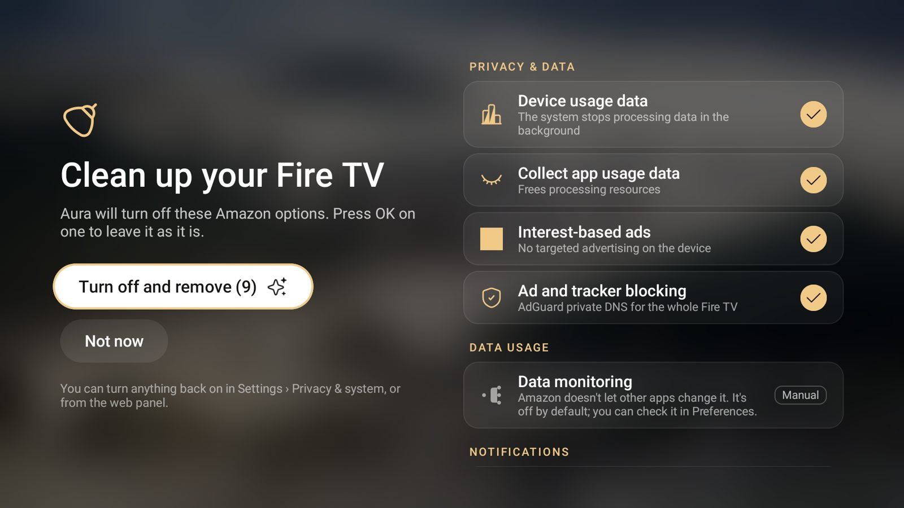
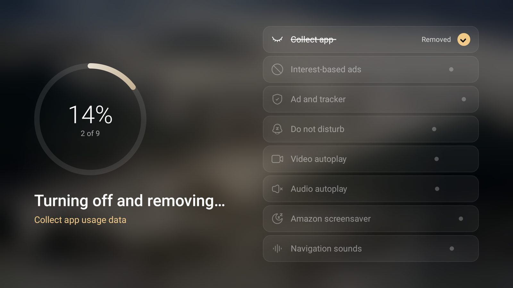
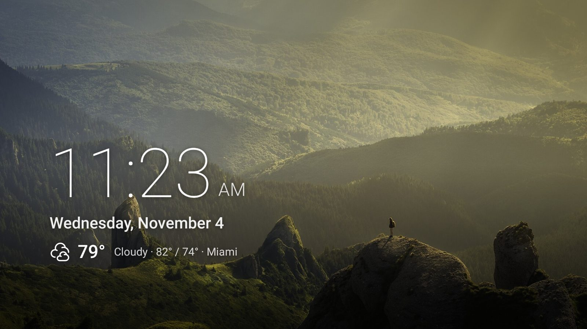
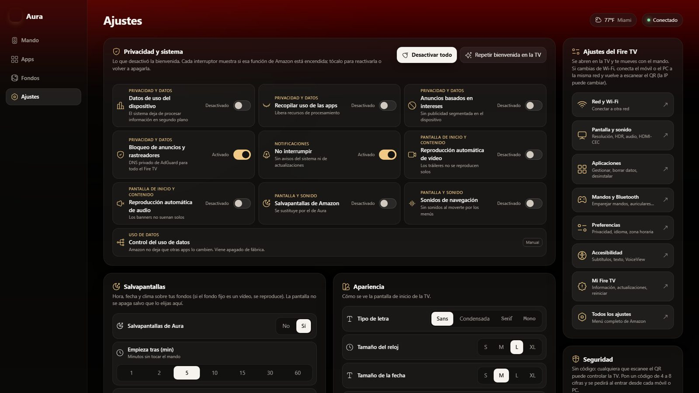

<p align="center"></p>

<h1 align="center">Aura</h1>

<p align="center"><b>Un inicio limpio, sin anuncios y a tu manera para Fire TV.</b><br>
Launcher para Amazon Fire TV (Fire OS 7/8) con panel web, salvapantallas propio, fondos de vídeo y control por voz.</p>

<p align="center"></p>

---

## Índice

1. [Qué hace](#qué-hace)
2. [Instalar en un Fire TV](#instalar-en-un-fire-tv)
3. [Permisos (y por qué hacen falta)](#permisos-y-por-qué-hacen-falta)
4. [Uso en la TV](#uso-en-la-tv)
5. [Panel web (móvil y PC)](#panel-web-móvil-y-pc)
6. [Control por voz (MCP)](#control-por-voz-mcp)
7. [Estructura del repositorio](#estructura-del-repositorio)
8. [Cómo funciona por dentro](#cómo-funciona-por-dentro)
9. [Desarrollo](#desarrollo)
10. [Publicar una versión nueva](#publicar-una-versión-nueva)
11. [Solución de problemas](#solución-de-problemas)
12. [Limitaciones conocidas](#limitaciones-conocidas)
13. [Créditos](#créditos)

---

## Qué hace

| | |
|---|---|
| **Inicio sin anuncios** | Una fila con tus apps en el orden que elijas, reloj, fecha y clima. El botón Inicio del mando siempre lleva a Aura. |
| **Bienvenida que limpia** | Al instalarla, desactiva con una animación el rastreo de Amazon, los anuncios por intereses, la reproducción automática de tráileres, los sonidos de navegación y el salvapantallas de Amazon. Todo se puede reactivar. |
| **Salvapantallas propio** | Hora, fecha y clima sobre tus fondos. La pantalla no se apaga salvo que lo configures. |
| **Fondos** | 18 fotos de naturaleza que cambian según la hora o según la app enfocada, fotos subidas por ti y **fondos de vídeo** (YouTube, enlace directo o archivo). |
| **Panel web** | Desde el móvil o el PC (escaneando un QR): mando a distancia, escribir, encender/apagar, ordenar apps, fondos, ajustes, ajustes del Fire TV, instalar y desinstalar apps. |
| **Seguridad** | Código de seguridad (PIN) opcional para el panel web y emparejamiento de dispositivos nuevos con aprobación en la TV. |
| **Control por voz** | Servidor MCP para que un asistente (por ejemplo Claude) maneje la TV: abrir apps, teclas, volumen, encender… |

<p align="center">
 <br>
 
</p>

---

## Instalar en un Fire TV

**Descarga:** la última versión siempre está en
[`Releases › latest › Aura.apk`](../../releases/latest/download/Aura.apk) (enlace fijo) y en la landing del proyecto (GitHub Pages).

### Opción A — Desde el PC con ADB (recomendada)

Es la única forma de conceder los permisos que necesita la bienvenida (ver [Permisos](#permisos-y-por-qué-hacen-falta)).

1. En el Fire TV: **Ajustes › Mi Fire TV › Opciones de desarrollador › Depuración ADB: activada**.
   (Si no ves "Opciones de desarrollador": *Mi Fire TV › Información*, pulsa 7 veces sobre el nombre del dispositivo.)
2. Mira la IP del Fire TV en *Mi Fire TV › Información › Red*.
3. En el PC, con [platform-tools](https://developer.android.com/tools/releases/platform-tools):

```powershell
adb connect 192.168.1.50:5555          # la TV pregunta "¿Permitir depuración?": acepta
adb install -r Aura.apk
adb shell pm grant com.david.aura android.permission.WRITE_SECURE_SETTINGS
adb shell appops set com.david.aura WRITE_SETTINGS allow
adb shell appops set com.david.aura SYSTEM_ALERT_WINDOW allow
adb shell appops set com.david.aura REQUEST_INSTALL_PACKAGES allow
adb shell cmd notification allow_dnd com.david.aura
adb shell settings put secure enabled_accessibility_services com.david.aura/com.david.aura.HomeWatcherService
adb shell settings put secure accessibility_enabled 1
adb shell am start -n com.david.aura/.MainActivity
```

Si tienes el código fuente, `scripts\deploy.ps1 -Device 192.168.1.50:5555` hace todo esto de una vez.

### Opción B — Solo con el mando (Downloader)

1. Instala **Downloader** desde la Appstore.
2. *Ajustes › Mi Fire TV › Opciones de desarrollador › Apps de origen desconocido* → activa Downloader.
3. En Downloader escribe el enlace directo a `Aura.apk` e instala.

Aura funciona, pero la bienvenida no podrá cambiar los ajustes del sistema hasta que hagas una vez los
comandos `pm grant` / `appops` de la opción A. El servicio de accesibilidad se puede activar a mano en
*Ajustes › Accesibilidad*.

### Actualizar

Instala el APK nuevo encima (`adb install -r` o desde el panel web, pestaña Apps). Las versiones
publicadas van firmadas con la misma clave, así que **no se pierden ajustes, token ni PIN**.
Fire OS desactiva el servicio de accesibilidad al actualizar; Aura lo reactiva sola si tiene el permiso
`WRITE_SECURE_SETTINGS` (si no, repite el comando `settings put secure enabled_accessibility_services …`).

---

## Permisos (y por qué hacen falta)

| Permiso | Cómo se concede | Para qué |
|---|---|---|
| Servicio de accesibilidad `HomeWatcherService` | ADB o Ajustes › Accesibilidad | Capturar el botón Inicio (Fire OS no deja cambiar de launcher), el mando web (navegar, escribir, capturas) y confirmar instalaciones pedidas desde la web. |
| `WRITE_SECURE_SETTINGS` | `pm grant` (solo ADB) | Bienvenida y *Privacidad y sistema*: datos de uso, anuncios, DNS de bloqueo, reproducción automática, salvapantallas, apagado. Reactivar la accesibilidad tras actualizar. |
| `WRITE_SETTINGS` | `appops` (solo ADB) | Sonidos de navegación y tiempo hasta el salvapantallas. |
| Acceso a No interrumpir | `cmd notification allow_dnd` (solo ADB) | Modo No interrumpir (deja pasar alarmas y el sonido de los vídeos). |
| `SYSTEM_ALERT_WINDOW` | `appops` (solo ADB) | Abrir Aura al encender el Fire TV. |
| `REQUEST_INSTALL_PACKAGES` | `appops` (solo ADB) | Instalar APKs subidos desde el panel web. |

Aura **no** ejecuta comandos de shell recibidos por la red: el panel solo acepta acciones de listas cerradas
(teclas fijas, apps instaladas, ajustes concretos).

---

## Uso en la TV

| Mando | Acción |
|---|---|
| **Inicio** | Vuelve a Aura (cierra paneles y enfoca la primera app). |
| **Inicio mantenido** | Abre los Ajustes de Aura. |
| **Menú (☰)** | Muestra el QR y el token para conectar el móvil. |
| **OK mantenido** en la fila principal | Modo mover: ◀ ▶ para cambiar el orden, OK para terminar. |
| **OK mantenido** en *Todas las apps* | Añadir o quitar de la fila principal. |
| Icono de engranaje | Ajustes de Aura: fondos, idioma, °C/°F, reloj, letra, tamaños, salvapantallas, *Privacidad y sistema*, código de seguridad, accesos a los ajustes del Fire TV y "Usar Aura como inicio". |

- **Desactivar Aura como inicio:** *Ajustes › Usar Aura como inicio: No*. El botón Inicio vuelve al de Amazon; Aura y la web siguen funcionando.
- **Repetir la bienvenida:** *Ajustes › Repetir la bienvenida* (o desde la web).
- **Olvidé el PIN:** *Ajustes › Código de seguridad*, pulsa OK dos veces para quitarlo (solo desde la TV).

### Salvapantallas y apagado

Cuando la bienvenida desactiva el salvapantallas de Amazon, Aura se encarga de los tiempos:

- Empieza tras *N* minutos sin tocar el mando (5 por defecto). **No aparece mientras se reproduce un vídeo**: las apps de vídeo mantienen la pantalla encendida; si pausas, sí.
- *Apagar la pantalla: Nunca* (por defecto) mantiene el salvapantallas indefinidamente; se puede elegir 30 min – 8 h.

---

## Panel web (móvil y PC)

En la TV pulsa **Menú** y escanea el QR, o abre `http://IP-DE-LA-TV:8765` en un navegador de la misma red.

- **Token:** el QR lo incluye. Sin QR, el panel puede **emparejarse**: la TV muestra un código de 4 cifras y pulsas *Permitir* con el mando.
- **Código de seguridad (PIN):** opcional (*Ajustes › Seguridad*). Con él, cada dispositivo nuevo debe escribirlo; tras 5 fallos se bloquea 5 minutos. Instalar/desinstalar apps lo pide otra vez.
- Solo responde a direcciones de la red local.

| Pestaña | Qué hay |
|---|---|
| **Mando** | Cruceta, teclas multimedia, volumen, encender/apagar (HDMI-CEC), escribir en la TV, captura de pantalla, abrir apps, ajustes del Fire TV. |
| **Apps** | Ordenar la fila (arrastrar o ▲▼), ocultar, iconos propios, instalar APK (archivo o enlace), desinstalar, buscar en la Appstore. |
| **Fondos** | Modo (según la app, la hora, rotar o fijo), franjas horarias, fondo por app, subir fotos, fondos de vídeo, créditos. |
| **Ajustes** | Privacidad y sistema, salvapantallas, general, apariencia, clima, seguridad, instalar como app (PWA). |

---

## Control por voz (MCP)

`mcp/aura_mcp.py` es un servidor [MCP](https://modelcontextprotocol.io) (stdio, sin dependencias, Python 3.9+)
con herramientas como `tv_abrir_app`, `tv_tecla`, `tv_volumen`, `tv_encender`, `tv_apagar`, `tv_escribir`,
`tv_captura`, `tv_listar_apps`, `tv_modo_fondo` y `tv_estado`.

1. Copia `.mcp.example.json` a la carpeta de tu proyecto como `.mcp.json` (no se sube a git: lleva secretos).
2. Rellena `AURA_HOST` (IP de la TV), `AURA_TOKEN` (en la TV: botón Menú) y `AURA_PIN` si activaste el código.
3. Reinicia tu cliente MCP (en Claude Code: `/mcp`).

> El token cambia si borras los datos de Aura en el Fire TV. Entonces actualiza `AURA_TOKEN`.

---

## Estructura del repositorio

```
aura-launcher/
├── app/                          App Android (Kotlin + Jetpack Compose)
│   └── src/main/
│       ├── java/com/david/aura/  Código (ver "Cómo funciona por dentro")
│       ├── assets/web/           Panel web (un solo index.html, sin build) + iconos
│       ├── assets/wallpapers/    Fondos de serie (Wikimedia Commons, ver credits.json)
│       └── res/                  Iconos vectoriales ri_* (generados), banner
├── mcp/aura_mcp.py               Servidor MCP (control por voz)
├── landing/                      Landing estática (GitHub Pages)
├── scripts/
│   ├── deploy.ps1                Compila e instala en la TV por ADB (+ permisos)
│   ├── release.ps1               Prepara una versión: sube número, CHANGELOG, commit y etiqueta
│   ├── release_info.py           Genera landing/release.js y las notas de la Release
│   ├── update-landing.ps1        Copia el último APK a la landing local
│   └── debloat-firetv.ps1        Opcional: desactiva apps de Amazon por ADB
├── tools/
│   ├── gen_icons.py              Genera iconos web y drawables desde Reicon
│   └── alt-build-dir.gradle      Compila en otra carpeta si el APK está bloqueado
├── .github/workflows/            build.yml (comprobación) y release.yml (publicación)
├── version.properties            Versión de la app (única fuente)
├── CHANGELOG.md                  Novedades por versión
└── keystore.properties.example   Plantilla para firmar en local
```

---

## Cómo funciona por dentro

Fire OS no permite elegir otro launcher, así que Aura combina varias piezas:

| Archivo | Papel |
|---|---|
| `MainActivity.kt`, `HomeScreen.kt` | Pantalla de inicio (Compose): fila de apps, fondo, reloj, clima, overlays. |
| `Services.kt` → `HomeWatcherService` | Servicio de accesibilidad: captura la tecla Inicio (`onKeyEvent`), vuelve a Aura si aparece el inicio de Amazon, abre Aura al arrancar. `WebService`: servicio en primer plano con el servidor web. `BootReceiver`. |
| `WebServer.kt` | API REST + panel (NanoHTTPD, puerto 8765). Solo LAN, token y PIN opcional. |
| `Remote.kt` | Teclas, texto, encender/apagar y capturas a través de la accesibilidad. |
| `Config.kt` | Configuración en `files/config.json` (kotlinx.serialization) con migraciones por `configVersion`. |
| `SystemTweaks.kt` | Lista cerrada de ajustes del sistema que cambia la bienvenida; los reaplica si Fire OS los revierte. |
| `Onboarding.kt` | Bienvenida con la animación "desactivando y eliminando". |
| `Screensaver.kt` | `AuraDream` (DreamService del sistema) y vista previa. |
| `Wallpapers.kt`, `Videos.kt` | Fondos: selección por franja/app, desenfoque para el efecto cristal, vídeo con ExoPlayer o el reproductor de YouTube. |
| `Installer.kt` | Instalar (PackageInstaller) y desinstalar apps pedidas desde la web. |
| `Security.kt`, `Pairing.kt` | PIN (PBKDF2, sesiones de 30 días) y emparejamiento con aprobación en la TV. |
| `TvSettings.kt`, `FireSettings.kt`, `Ui.kt` | Ajustes en la TV, accesos a los ajustes de Amazon, textos ES/EN y estilos. |

### API

Todas las rutas `/api/*` (salvo `ping`, `pair` y `pair/status`) necesitan la cabecera `X-Token` (o `?token=`) y,
con PIN activado, `X-Session` (se obtiene en `/api/login`).

| Ruta | Uso |
|---|---|
| `GET /api/ping` | ¿Hay Aura? ¿pide PIN? |
| `POST /api/pair`, `GET /api/pair/status` | Emparejar un dispositivo nuevo. |
| `POST /api/login` · `/api/pin` · `/api/verify-pin` | Sesión con PIN, activar/cambiar/quitar PIN, comprobarlo. |
| `GET /api/state` | Todo el estado (apps, fondos, config, clima, ajustes del sistema, versión…). |
| `GET/POST /api/config` | Leer o cambiar ajustes (JSON parcial). |
| `POST /api/key` · `/api/text` · `/api/power` · `GET /api/screenshot` | Mando: tecla, texto, encender/apagar, captura. |
| `POST /api/launch` · `/api/fire-settings` · `/api/appstore` | Abrir app, pantalla de ajustes de Amazon, búsqueda en la Appstore. |
| `POST /api/install` · `/api/uninstall`, `GET /api/install` | Instalar/desinstalar y estado. |
| `POST /api/tweaks` · `/api/onboarding` · `/api/screensaver` | Ajustes del sistema, repetir bienvenida, ver salvapantallas. |
| `/api/wallpaper` · `/api/wallpaper-thumb` · `/api/video` · `/api/icon` · `/api/app-icon` | Fondos, vídeos e iconos. |

---

## Desarrollo

**Requisitos:** Windows con Android Studio (se usa su JDK, `jbr`), Android SDK, `adb` en el PATH y Python 3.
El proyecto usa AGP 9.2, Kotlin 2.3, Gradle 9.4 (wrapper incluido), `compileSdk 36`, `targetSdk 30`.

```powershell
# Compilar (debug), instalar en la TV y conceder permisos
.\scripts\deploy.ps1 -Device 192.168.1.50:5555      # o fija $env:AURA_DEVICE

# Compilar la versión firmada (como la de GitHub) e instalarla
.\scripts\deploy.ps1 -Release

# Solo instalar el último APK compilado
.\scripts\deploy.ps1 -SkipBuild
```

- **Panel web:** es `app/src/main/assets/web/index.html` (HTML + CSS + JS sin dependencias). Se empaqueta en el APK: hay que recompilar para verlo en la TV.
- **Iconos:** `python tools/gen_icons.py ruta/a/icons.json` (de `@iconify-json/reicon`) regenera `icons.js` y los `ri_*.xml`. Añade los nombres que necesites a las listas del script.
- **Poca memoria:** `gradle.properties` usa una JVM pequeña. Si Gradle dice *Could not reserve enough space for object heap*, cierra programas (WSL, emulador…) y repite.
- **APK bloqueado** (abierto en un emulador): `deploy.ps1` lo detecta y compila en `..\aura-build`.
- Las compilaciones debug son depurables: `adb shell run-as com.david.aura cat files/config.json` muestra la configuración (incluido el token). Las release no lo permiten.

---

## Publicar una versión nueva

### Una sola vez: preparar el repositorio en GitHub

1. Crea el repositorio y sube el código:
   ```powershell
   git remote add origin https://github.com/TU_USUARIO/aura-launcher.git
   git push -u origin main
   ```
2. **Secretos de firma** (*Settings › Secrets and variables › Actions › New repository secret*).
   Las versiones deben firmarse siempre con la misma clave para que se instalen encima.
   Para seguir usando la clave con la que ya está instalada Aura (la de depuración de Android Studio):

   | Secreto | Valor |
   |---|---|
   | `AURA_KEYSTORE_BASE64` | El keystore en base64 (comando abajo) |
   | `AURA_KEYSTORE_PASSWORD` | `android` |
   | `AURA_KEY_ALIAS` | `androiddebugkey` |
   | `AURA_KEY_PASSWORD` | `android` |

   ```powershell
   # Copia el keystore en base64 al portapapeles
   [Convert]::ToBase64String([IO.File]::ReadAllBytes("$env:USERPROFILE\.android\debug.keystore")) | Set-Clipboard
   ```
   > Guarda una copia de `debug.keystore`: si se pierde, las versiones nuevas no podrán instalarse encima
   > (habría que desinstalar Aura y se perderían los ajustes).
3. **Landing en GitHub Pages:** *Settings › Pages › Build and deployment › Source: GitHub Actions*.
4. **Firma en local** (opcional, para `deploy.ps1 -Release`): copia `keystore.properties.example` como `keystore.properties` y ajusta la ruta.

### Cada versión

1. Mientras trabajas, apunta los cambios en `CHANGELOG.md`, sección `## [Sin publicar]` (una línea por cambio, empezando por `- `).
2. (Opcional) Prueba la versión firmada en tu TV: `.\scripts\deploy.ps1 -Release`.
3. Publica:
   ```powershell
   .\scripts\release.ps1 -Version 1.8 -Push
   ```
   El script comprueba que no haya cambios sin commit, sube `versionName` y `versionCode` en `version.properties`,
   convierte `[Sin publicar]` en `[1.8] - fecha`, hace commit, crea la etiqueta `v1.8` y la sube.
   Sin `-Push` solo lo deja preparado en local (te dice cómo subirlo o deshacerlo). Con `-Test` antes compila e instala la release en la TV.
4. GitHub Actions (`release.yml`) compila el APK firmado, comprueba que la etiqueta coincide con la versión, crea la **Release** con
   `Aura-1.8.apk` y `Aura.apk`, y publica la **landing** con los datos y novedades de esa versión. Sigue el progreso en la pestaña *Actions*.

**Enlaces fijos para compartir:**
- Última versión: `https://github.com/TU_USUARIO/aura-launcher/releases/latest/download/Aura.apk`
- Landing: `https://TU_USUARIO.github.io/aura-launcher/`

**Reglas:** `versionCode` siempre sube (Android rechaza instalar un código menor o igual); la versión solo se cambia con `release.ps1`; no subas nunca `keystore.properties`, `*.keystore` ni `.mcp.json` (el `.gitignore` ya los excluye).

---

## Solución de problemas

| Problema | Solución |
|---|---|
| El botón Inicio abre el inicio de Amazon | El servicio de accesibilidad se desactivó (pasa al actualizar). Repite `settings put secure enabled_accessibility_services …` o usa `deploy.ps1`. Comprueba también *Ajustes › Usar Aura como inicio*. |
| La web dice "Token incorrecto" | Se borraron los datos de Aura y el token cambió. Pulsa Menú en la TV y vuelve a escanear el QR (o empareja). Actualiza `AURA_TOKEN` del MCP. |
| `adb` dice *unauthorized* | Acepta en la TV el aviso "¿Permitir depuración?". Si no aparece: `adb kill-server` y `adb connect` de nuevo. |
| `INSTALL_FAILED_UPDATE_INCOMPATIBLE` | El APK está firmado con otra clave. Usa la misma clave (ver *Publicar*) o desinstala Aura (se pierden los ajustes). |
| La bienvenida dice "Sin permiso" | Faltan los permisos de ADB (ver *Permisos*). |
| Tras reiniciar sale "No se detecta el mando" | Es un aviso de Fire OS mientras el mando se reconecta; no es de Aura. |
| La IP de la TV cambió | Escanea el QR de nuevo. Conviene reservar la IP del Fire TV en el router. |

---

## Limitaciones conocidas

- **Control del uso de datos** de Amazon no se puede cambiar desde otra app (lo protege un permiso de sistema); aparece como "Manual".
- El **menú rápido** de Amazon (Inicio mantenido) no se puede abrir desde una app: en Aura abre sus propios ajustes.
- Las teclas enviadas por ADB (`input keyevent`) no pasan por el filtro de accesibilidad; la captura de Inicio solo se nota con el mando físico.
- Instalar apps siempre pasa por la ventana de confirmación de Fire OS (Aura la acepta solo si la petición vino de la web con el PIN).

---

## Créditos

- Fotos de los fondos: **Wikimedia Commons**, con autor y licencia de cada una en `app/src/main/assets/credits.json` (también en el panel web, pestaña Fondos).
- Iconos: [Reicon](https://reicon.dev) (MIT).
- Librerías: Jetpack Compose, AndroidX Media3 (ExoPlayer), NanoHTTPD, ZXing, kotlinx.serialization y kotlinx.coroutines.
- Clima: [Open-Meteo](https://open-meteo.com).

Aura es un proyecto personal y no está afiliado a Amazon. *Fire TV* y *Fire OS* son marcas de Amazon.
